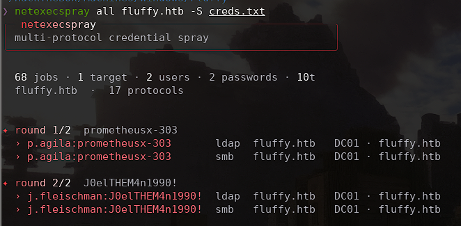
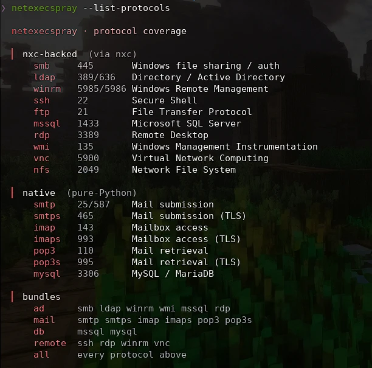

# netexecspray

A multi-protocol password sprayer that wraps **NetExec (`nxc`)** and adds native
Python sprayers for mail/db services. Sprays usernames and passwords (or an NTLM
hash, or a `user:pass` list) across many protocols and targets, with a minimal
live UI, lockout-aware pacing, and ready-to-use loot output.

Based on [netexecspray](https://github.com/I-AlanF90/netexecspray) by I-AlanF90.

> **For authorized security testing and educational use only.** Only run this
> against systems you own or are explicitly authorized to test (your own lab,
> an HTB/THM box, or an engagement with written permission).

## Screenshots

Spray run with round-by-round hits:



Protocol catalogue (`--list-protocols`):



## Features

- **Protocols**: nxc-backed (`smb ldap winrm ssh ftp mssql rdp wmi vnc nfs`),
  native (`smtp smtps imap imaps pop3 pop3s mysql`), plus bundles `ad`, `mail`,
  `db`, `remote`, `all`. `--list-protocols` prints the full catalogue.
- **Credentials**: user/password files or inline lists (`-u/-U` + `-p`), NTLM
  hash (`-H`), paired `user:pass` combos (`-c`), or a pooled spray file (`-S`).
- **Targets**: IP, hostname, domain, CIDR, or a file of targets, with optional
  DNS resolution (`--resolve`).
- **Lockout safety**: `--max-attempts`, `--pass-pol`/`--safe`,
  `--lockout-delay`, `--rate`, `--jitter`, and `--resume` to continue a prior run.
- **Validation** (`--validate`): a secondary nxc check to confirm real access.
- **Live UI**: a minimal progress bar with a rate sparkline and running hit
  count. Only valid credentials print, one aligned line each. `--no-color`
  strips styling, `--bell` rings on confirmed access.
- **Output**: nothing is written unless requested. `--output` for a log file,
  `--out-dir` for loot files, `--report` for a Markdown report, `--json` for
  structured output.
- **Pre-flight**: `--null`/`--guest` probe anonymous or guest sessions first.
- **Proxy**: `--proxychains` routes nxc through proxychains.

## Requirements

- Python 3.8+ (standard library only, no required pip installs)
- NetExec (`nxc`) in `PATH`
- Optional: `pymysql` for the mysql sprayer, `proxychains` for `--proxychains`

Tested on Kali Linux.

## Installation

```bash
git clone https://github.com/zingerw1/netexecsprayer.git
cd netexecsprayer
```

Run it straight from the clone, or install it:

```bash
./netexecspray.py ad 10.10.10.1 -u users.txt -p 'Pass'
python3 -m netexecspray ad 10.10.10.1 -u users.txt -p 'Pass'

pip install .                 # core, stdlib only
pip install '.[mysql]'        # with PyMySQL for the native mysql sprayer
```

## Project layout

```
netexecspray.py        launcher shim
netexecspray/
  state.py       shared runtime state and locks
  theme.py       palette, glyphs, colour/gradient primitives
  protocols.py   protocol catalogue, default ports, bundle expansion
  parsing.py     classify/explain nxc and native output
  runners.py     talk to targets: nxc, validation, lockout policy, native sprayers
  results.py     log, loot, csv, report, and json sinks
  ui.py          all terminal output
  loaders.py     targets, credential lists, resume parsing
  worker.py      per-attempt spray logic, rate gate, pre-flight probes
  cli.py         argument parsing and orchestration
```

## Usage

Spray one protocol:
```bash
netexecspray smb 192.168.1.10 -u Alan -p 'Sup3rS3cretPass!'
```

Inline comma-lists, no files needed:
```bash
netexecspray smb 10.10.10.1 -u user1,user2 -p pass1,pass2
```

Spray the AD bundle across a subnet, pacing to the lockout policy:
```bash
netexecspray ad 10.129.0.0/24 -u users.txt -p 'Winter2025!' --safe
```

Pass-the-hash across everything:
```bash
netexecspray all dc01.corp.local -u users.txt -H :32ed87bdb5fdc5e9cba88547376818d4
```

Paired credential stuffing from a `user:pass` list:
```bash
netexecspray smb 10.10.10.1 -c creds.txt
```

Confirm real access and collect loot plus a report:
```bash
netexecspray ad targets.txt -u users.txt -p 'Pass' --validate --out-dir loot/ --report engagement.md
```

Resume a previous run and rate-limit:
```bash
netexecspray ad targets.txt -u users.txt -p p.txt --resume spray_prev.log --rate 5
```

## Reading results

Only valid credentials print, one line each:

- `✦ admin`: confirmed execution or real access, likely lateral movement.
- `› valid`: credentials are good, access may be restricted.
- `⊘ locked`: account locked out, skipped for the rest of the run.

Hits also go to `<log>.valid.txt` and `<log>.pwned.txt`, with the full audit
trail in `<log>.csv`, the log file, and the JSON/report.

## Notes

- CIDRs are expanded to hosts by default. Use `--no-expand-cidr` to hand the
  CIDR to nxc directly, or `--force` for very large ranges.
- `--resume` matches on `proto:target:user:secret`; most reliable for password
  sprays since hashes are truncated in logs.
- `--proxychains` only covers nxc-backed protocols; native sprayers are skipped.
