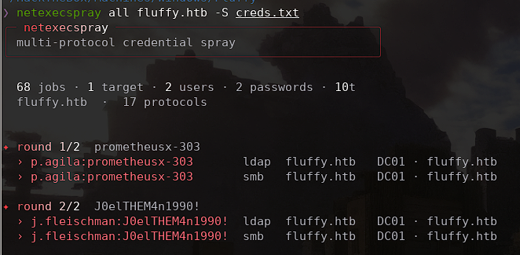

# netexecspray

> **Authorized security testing only.** Run this only against systems you own
> or are explicitly authorized to test.

## Install

```bash
git clone https://github.com/zingerw1/netexecsprayer.git
cd netexecsprayer
pip install .                 # or: pip install '.[mysql]' for native mysql
```

Requires Python 3.8+ and `nxc` in `PATH`.

## Usage

```bash
netexecspray smb 192.168.1.10 -u Alan -p 'Sup3rS3cretPass!'
netexecspray ad 10.129.0.0/24 -u users.txt -p 'Winter2025!' --safe
netexecspray all dc01.corp.local -u users.txt -H :32ed87bdb5fdc5e9cba88547376818d4
netexecspray smb 10.10.10.1 -c creds.txt
netexecspray ad targets.txt -u users.txt -p 'Pass' --validate --out-dir loot/ --report engagement.md
```

- **Protocols**: `--list-protocols` for the full catalogue; bundles `ad`,
  `mail`, `db`, `remote`, `all`.
- **Credentials**: user/pass files or inline lists, NTLM hash (`-H`),
  `user:pass` pairs (`-c`), or a pooled spray file (`-S`).
- **Lockout safety**: `--max-attempts`, `--safe`, `--lockout-delay`, `--rate`,
  `--jitter`, `--resume`.
- **Output**: nothing written unless requested — `--output`, `--out-dir`,
  `--report`, `--json`.

## Results

Only valid credentials print: `✦ admin` (confirmed access), `› valid`
(credentials good), `⊘ locked` (skipped). Hits also land in
`<log>.valid.txt`/`<log>.pwned.txt`, with full detail in the CSV/JSON/report.

## Screenshot


